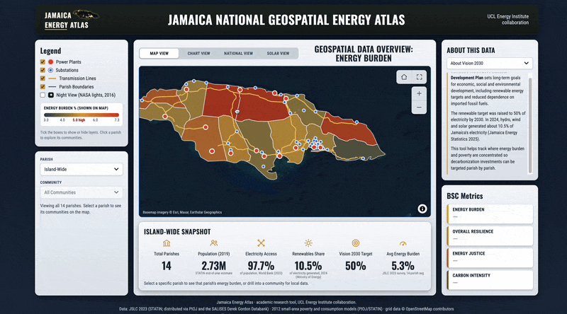

# Jamaica Energy Atlas


## Overview
The Jamaica Energy Atlas is a decision-support tool for equitable decarbonization, built as a self-contained web page (HTML, CSS and JavaScript with Plotly.js). It provides parish- and community-level analysis of energy burden, poverty, and grid infrastructure across Jamaica, designed to show where the country stands today relative to its Vision 2030 renewable energy goals and where investment could be targeted most effectively.

Jamaica's Vision 2030 National Development Plan (published 2009) originally set a goal of 20% renewables by 2030; that target was increased in 2018 to 50%. Current renewable generation sits around 10.5% (2024, Ministry of Energy). This tool is built to help visualize the gap between where Jamaica is and where it needs to be — parish by parish, community by community — rather than only at the national level.

The atlas is a single page, `index.html`, with four views: **Map View** (parish energy burden from the JSLC 2023 survey, a drill-down to 772 communities colored by 2012 poverty rate, and the electricity grid, plus a Night View switch showing NASA's night lights); **Chart View** (energy burden by parish and by consumption quintile, and recorded power plant capacity by fuel); **National View** (Ministry of Energy statistics, and renewable electricity scenarios from a published study); and **Solar View** (a solar potential map and a rooftop solar calculator). A Balanced Scorecard is planned for a later phase — see Outputs.

Built in connection with a UCL collaboration with UCL Energy Institute's Island and Coastal Resilience Lab, and inspired by tools including the Drawdown GA Emissions and Climate Solutions Trackers, the U.S. DOE's LEAD and SLOPE Tools, and PIOJ's Vision 2030 monitoring dashboards.

## Demo / Example
Open `index.html` in any modern browser. It needs an internet connection for the map library, fonts and satellite imagery, but no other files: all of its data is built into the page. The same single file can be published as-is on GitHub Pages or any web server.

## Data Sources
| Name/Description | Originator/Provider | Access Link | Date Accessed | License/Restrictions |
|---|---|---|---|---|
| Jamaica Parish Boundaries (GeoJSON) — `ja_parishes.json` | SimpleMaps | [simplemaps.com/gis/country/jm](https://simplemaps.com/gis/country/jm) | June 2026 | Free tier, see SimpleMaps terms |
| Incidence of Poverty, Jamaica (2012) — community-level poverty rate (`Per_Tot_Po`) | PIOJ / STATIN (ArcGIS small-area model) | ArcGIS web map, scraped via custom `grab_data.py` script into `jamaica_poverty_2012.geojson` | June 2026 | Public PIOJ data |
| Household Consumption per Equivalent Adult, Jamaica (2012) — community-level consumption (`av_CONS`) | PIOJ / STATIN (ArcGIS small-area model) | ArcGIS web map, scraped via custom `grab_data.py` script into `jamaica_consumption_2012.geojson` | June 2026 | Public PIOJ data |
| Jamaica Survey of Living Conditions (JSLC) Annual 2023 microdata — Annual Electricity Bill, Total Annual Expenditure, Household Size (members only), Per Capita Consumption (members only), Per Capita Population Quintile and Area Code, per-household | Statistical Institute of Jamaica (STATIN) [producer]; distributed via Planning Institute of Jamaica (PIOJ) and the SALISES Derek Gordon Databank, UWI Mona | Provided via Richard Leach under a SALISES Derek Gordon Databank, The University of the West Indies, Mona data use agreement | June 2026 | Non-commercial research/teaching use only — see Data Use Terms below |
| End-of-year population by parish, 2019 — `eoy_parish_pop_2019.csv` (island total 2,734,093; shown in the island and parish snapshots) | Statistical Institute of Jamaica (STATIN) | [statinja.gov.jm](https://statinja.gov.jm/Demo_SocialStats/PopulationStats.aspx) | June 2026 | Public STATIN data |
| Access to electricity (% of population) — 97.7% for Jamaica (2023), shown as "Electricity Access" on the snapshot | World Bank (SDG 7.1.1 Electrification Dataset) | [data.worldbank.org](https://data.worldbank.org/indicator/EG.ELC.ACCS.ZS) | October 2026 | CC BY 4.0 |
| Jamaica Energy Statistics 2025 — Tables 1, 2, 4 and 8 and the JPS rate table (fuel imports, oil and gas use, refinery prices, electricity generation, sales and rates), covering 2021–2025; used for the National View and the snapshot's "Renewables Share" (10.5% in 2024) | Ministry of Energy, Transport and Telecommunications, Energy Economics and Planning Unit (published July 2026) | [mset.gov.jm/statistics](https://www.mset.gov.jm/statistics/) | October 2026 | Public government data |
| National Energy Balance 2024 — final energy use by sector | Ministry of Science, Energy, Telecommunications and Transport (published September 2025) | [mset.gov.jm/statistics](https://www.mset.gov.jm/statistics/) | October 2026 | Public government data |
| Global Solar Atlas 2.0 — photovoltaic power potential (PVOUT), long-term yearly totals on an approximately 1 km grid; used for the Solar View | World Bank Group / ESMAP; data © Solargis | [globalsolaratlas.info](https://globalsolaratlas.info) — Jamaica GIS data (GeoTIFF) | October 2026 | CC BY 4.0 |
| NASA Black Marble night lights (VIIRS, 2016 composite) — Night View switch on the Map View | NASA, served by NASA GIBS | Loaded live by the page from [gibs.earthdata.nasa.gov](https://gibs.earthdata.nasa.gov) | October 2026 | Free and open (NASA data policy) |
| Richards & Yabar (2024), "Jamaica's Renewable Energy Transition: Pathways and Challenges to Achieving 50% Renewable Electricity by 2030" — scenario figures | International Journal of Environmental Sciences & Natural Resources 34(2) | [juniperpublishers.com](https://juniperpublishers.com/ijesnr/IJESNR.MS.ID.556385.php) | October 2026 | Journal article (figures cited, not redistributed) |
| OSM Power Infrastructure (transmission lines, substations, power plants, generators) — current file `overpass_energy_infra_2_390c7e.geojson` | OpenStreetMap contributors, via Overpass Turbo | [overpass-turbo.eu](https://overpass-turbo.eu) — two queries run June 8, 2026 and June 15, 2026 (second query added `generator` and `relation` types); current file exported June 15, 2026 | June 8 & 15, 2026 | ODbL |
| Open Infrastructure Map — cross-check: 20 power plants, 1,081 MW and 741 km of power lines in Jamaica (stats page updated 2026-10-15) | Open Infrastructure Map | [openinframap.org](https://openinframap.org/stats/area/Jamaica) and [plant list](https://openinframap.org/stats/area/Jamaica/plants) | October 2026 | Data ODbL; analysis CC-BY |
| Satellite basemap imagery | Esri, Maxar, Earthstar Geographics (World Imagery tiles) | Loaded live by the page | — | Attribution required (shown on the map); check Esri terms before a public launch |
| GeoFabrik Jamaica OSM extract (roads, waterways, landuse, buildings, POIs, etc.) | GeoFabrik, via OpenStreetMap | [download.geofabrik.de/central-america/jamaica.html](https://download.geofabrik.de/central-america/jamaica.html) — downloaded as `.gpkg`, layers exported to GeoJSON via QGIS | June 2026 | ODbL |
| Population and Dwelling Counts by Community (not yet used by the current atlas) | Statistical Institute of Jamaica (STATIN), 2022 Population Census | [statinja.gov.jm/PopCensus/Census2022/Population and Dwelling counts by Community.aspx](https://statinja.gov.jm/PopCensus/Census2022/Population%20and%20Dwelling%20counts%20by%20Community.aspx) | June 2026 | Public STATIN data |

**Not yet integrated but downloaded for future use:** additional GeoFabrik layers (roads, waterways, water, landuse, places, transport, POIs, parking/gas, road infrastructure, houses of worship, buildings) — held locally in `assets/geofabrik/` for later work (e.g. parish-wide rooftop solar totals).

### Data Use Terms — JSLC 2023 Microdata

Access to the JSLC 2023 microdata used for parish-level energy burden calculations is governed by a data use agreement with the **SALISES Derek Gordon Databank** (Sir Arthur Lewis Institute of Social and Economic Studies, UWI Mona). Per that agreement:

1. **Purpose:** This data is used only for non-commercial research/teaching purposes.
2. **Confidentiality:** No attempt is made to identify individuals or institutions from this data — all figures shown in this Atlas are aggregated to the parish level (14 parishes, no household-level data is displayed). The household-level survey file itself is not published; the atlas and its data files contain only parish averages and household counts.
3. **Acknowledgement:** The original depositor (Statistical Institute of Jamaica) and the SALISES Derek Gordon Databank are both credited (see citation below). STATIN and PIOJ bear no responsibility for this project's further analysis or interpretation of the data.
4. **Citation:**

   > Statistical Institute of Jamaica. *Jamaica Survey of Living Conditions, 2023* [Micro-data set]. Kingston, Jamaica: Statistical Institute of Jamaica [producer], 2023. Kingston, Jamaica: Planning Institute of Jamaica and Derek Gordon Databank, The University of the West Indies, Mona Campus [distributors], 2026.

## Data Processing and Methodology

### Software/Tools Used
- **The atlas page:** HTML, CSS and vanilla JavaScript; [Plotly.js](https://plotly.com/javascript/) 2.35.2 (MapLibre-based `choroplethmap` and `scattermap` traces) for the map and charts; Oswald and Roboto Condensed fonts (Google Fonts, SIL Open Font License)
- **Data preparation (Python):** GeoPandas, Shapely, Pandas and NumPy; `pyreadstat` reads the SPSS `.sav` microdata; `rasterio` reads the Global Solar Atlas GeoTIFF
- **NASA GIBS** — night-lights map tiles, loaded live
- **Overpass Turbo** — OSM infrastructure querying
- **QGIS** — GeoFabrik `.gpkg` layer export to GeoJSON

### Key Processing Steps

**CRS correction.** The 2012 poverty and consumption GeoJSON files reported their CRS as EPSG:4326 (standard lat/lon), but their actual coordinate values were in EPSG:3857 (Web Mercator meters) — a mislabeling from the original scrape. Both files are force-reassigned to EPSG:3857 and then properly reprojected to EPSG:4326 before use.

**Parish name normalization.** Parish names appear inconsistently across source files (e.g. "ST. THOMAS", "St.Elizabeth", "Saint Andrew"). A normalization function strips punctuation, standardizes casing, and converts "SAINT" to "ST" to produce a consistent join key used across every dataset.

**Energy burden calculation (parish-level).** Using JSLC 2023 Annual microdata (1,719 households): `energy_burden_pct = (Annual Electricity Bill ÷ Total Annual Expenditure) × 100`, calculated per household, then averaged by parish. This is adapted from the U.S. DOE LEAD Tool's definition of energy burden (home energy costs as a share of income): the JSLC records only the electricity bill, and it has no reliable income data, so total expenditure is used instead (income is commonly underreported in surveys; expenditure is the standard substitute welfare measure). Averages are unweighted (the extract has no survey weights), and the 460 households that report no electricity bill are counted as 0%. Parish samples range from 56 to 318 households.

**Household size and consumption quintiles.** The parish snapshot shows average household size (members only) from the JSLC. The Chart View splits households into five equal groups by consumption per person (the survey's own quintile variable) and shows average energy burden for each group, for all households and separately for the Greater Kingston Metropolitan Area, other urban areas and rural areas. These averages are unweighted.

**Poverty rate and consumption (community-level).** Sourced from a 2012 PIOJ/STATIN small-area statistical model, which combines sparse JSLC survey responses with the complete 2011 Population Census to estimate values for individual communities — far more granular than JSLC's own household sample could support directly. These are modeled estimates, not direct measurements, and are labeled as such throughout the app. The consumption layer is titled "Household Consumption per Equivalent Adult" and is labeled that way in the atlas. The source GeoJSON also contains a second, overlapping set of constituency-labelled shapes with no community ID, name or estimate; these are excluded, leaving 772 communities (770 with a poverty estimate). Community outlines are simplified to about 55 m for web use. The 2012 layer has no community shapes for some areas inside a parish, so those areas appear empty when a parish is selected.

**Parish boundaries and population.** Parish outlines come from `ja_parishes.json`. The island population on the snapshot is the 2019 end-of-year total (2,734,093) from STATIN; each parish's 2019 population appears in its parish snapshot.

**OSM infrastructure extraction.** Two Overpass Turbo queries were run (June 8 and June 15, 2026). The first query returned 3,832 elements (180 ways, 3,652 nodes) but used simple line/node tagging only. The second, more complete query added `generator` and `relation` types. The current export (`overpass_energy_infra_2_390c7e.geojson`) contains 280 features: 95 transmission lines (717 km), 19 minor lines (20 km), 48 substations, 18 `power=plant` polygons and 100 `power=generator` features (62 wind turbines, 19 gas and 14 oil units, 4 solar, 1 unspecified).

**Plant selection and reconciliation.** Wind farms are not tagged as plants in OSM: they are stored as individual turbines grouped into named relations. The atlas rebuilds three wind farms from those relations (Wigton Windfarm 62.7 MW, BMR Jamaica Wind Limited 36.3 MW, Munro Wind Farm 3.0 MW; 59 turbines, 102.0 MW). Together with the plant polygons, this reconciles with Open Infrastructure Map's table (gas 5 plants / 494 MW, oil 5 / 421 MW, hydro 4 / 7.2 MW, wind 3 / 102 MW, solar 57 MW; 1,081 MW in total, against 1,081.1 MW here). The map shows 19 plants: the 15 named plant polygons, the unnamed JPS hydro plant, and the three wind farms. Two tiny unnamed solar polygons are not drawn. Open Infrastructure Map counts 3 solar plants and this file has 4 solar polygons. Capacities are as tagged in OSM; several plants have none, so capacity totals are a floor.

**National View (Ministry statistics).** All charts except one come from a single source, Jamaica Energy Statistics 2025 (published July 2026, covering 2021–2025; 2025 figures are preliminary): electricity generation by source and sales by customer type (2024 shares), electricity prices by customer class, grid losses, oil and gas use by activity, fuel imports, and refinery prices. "Where Jamaica's energy is used" comes from the National Energy Balance 2024. The renewables share is hydro + wind + solar as a share of total net generation (10.5% in 2024). Losses are shown as published; for 2023 and 2025 they differ from generation minus sales by about 0.03%.

**Renewable electricity scenarios.** The scenarios chart plots only figures published in Richards & Yabar (2024): their business-as-usual trend (23.5% renewable electricity in 2030, 37% in 2050), the national 50%-by-2030 target, and the finding they cite that 100% renewable electricity by 2050 is technically feasible (Loy et al., 2021). These are shown against the Ministry's actual renewables share for 2021–2025. The only calculation added is the pace needed to reach 50% by 2030 from the 2025 level (about 8 percentage points a year, versus about 0.7 a year on the paper's trend).

**Solar potential and calculator.** Solar potential comes from the Global Solar Atlas PVOUT layer: the electricity a typical fixed solar system at the best tilt produces per kW of panels per year, with standard losses included (1,142 to 1,791 kWh across Jamaica's land area). Each parish's figure is the average of the grid cells inside it, and the map is trimmed to land. The calculator multiplies system size by the parish figure. It estimates average household use as the parish's average JSLC 2023 electricity bill divided by the 2023 residential rate (J$55.14/kWh, Jamaica Energy Statistics 2025), and values only the electricity used at home at that rate.

**Night View.** NASA Black Marble tiles (VIIRS, 2016, the most recent year NASA publishes for this layer) are loaded live from NASA GIBS. NASA serves them up to zoom level 8, so the map stretches those tiles when zoomed in further. When the switch is on, the burden and poverty colors are hidden so the lights show, while the grid layers stay visible.

### Assumptions Made
- Total Annual Expenditure is used as the welfare proxy for energy burden calculations, since JSLC does not collect reliable household income data.
- 2012 small-area poverty/consumption estimates are treated as broadly indicative of current community-level conditions, despite their age — this is flagged explicitly in the app's "About This Data" panel rather than presented as current data.
- OSM-sourced infrastructure data is assumed reasonably representative of Jamaica's grid, though coverage may be incomplete in rural parishes given OSM's contributor-dependent nature.
- Energy burden averages are unweighted, and households with no electricity bill count as 0%, which lowers every parish average. Parish samples are small (56 to 318 households), so small differences between parishes should be read with caution.
- The 5% "high burden" line is a benchmark used in this atlas, not an official Jamaican threshold.
- Community poverty colors are relative to each parish (they span the middle 90% of that parish's values), so the same color in two parishes does not mean the same rate.
- The snapshot's "Electricity Access" (97.7%, World Bank, 2023) and "Renewables Share" (10.5% of 2024 net generation from hydro, wind and solar, Jamaica Energy Statistics 2025) are national figures. The 50% Vision 2030 target is the national goal.
- The scenarios are the published figures of one study (Richards & Yabar, 2024), not a model built for this atlas. Its trend starts from about 13% renewables in 2020; the Ministry's data show the share at 10–12% since, so its business-as-usual path is optimistic relative to recent years.
- Solar calculator results are estimates. They use parish averages, assume a typical system at the best tilt (roof direction and shading are not known), and treat the average electricity bill divided by the average residential rate as household use. Surplus electricity sold to the grid earns less than the residential rate and is not counted.
- Night lights show where light is visible from space in 2016; they are not a measure of who has reliable electricity today.
- The fuel-source chart shows installed capacity (MW) as recorded in OpenStreetMap (1,081 MW across the 19 plants shown), not electricity generated. Five plants (1 gas, 1 oil and 3 hydro, including Old Harbour and Rockfort) have no capacity recorded and are left out of the shares, so hydro in particular is understated.
- The Balanced Scorecard (BSC) panel is intentionally blank until its metrics are defined.

## Project Structure
```
JA-Energy-Atlas/
├── index.html      # The atlas (open this)
└── README.md
```
The data files listed under Data Sources, and the scripts that prepared them (such as `grab_data.py`), are kept on the author's computer and are not included in this repository. The restricted household-level JSLC survey file is never published.

## Setup & Usage

### View or host the atlas
Open `index.html` in a browser, or upload that one file to GitHub Pages or any web host. No installation is needed.

### Updating the data
`index.html` contains all of its data. It was generated from the data files listed under Data Sources (kept on the author's computer) with Python (GeoPandas). When the underlying data changes, the page has to be regenerated; the generation scripts are not part of this repository.

## Outputs

**Implemented:**
- **Map View:** parish choropleth of energy burden (JSLC 2023); selecting a parish colors its communities by 2012 poverty rate and mutes the other parishes; parish and community drill-down by dropdown or by clicking the map, with a parish or community snapshot (including 2019 population and average household size)
- **Grid layers:** transmission lines, 48 substations and 19 power plants (hover for fuel, capacity and operator; wind farms show turbine counts; substations show name and voltage where recorded), switchable from the legend
- **Night View switch:** NASA night lights (2016) with the grid on top
- **Chart View:** energy burden by parish against the 5.0% benchmark, energy burden by consumption quintile (all households and by area), and recorded power plant capacity by fuel
- **National View:** renewable electricity scenarios against actuals, electricity generation and sales (2024 shares), electricity prices by customer class, grid losses, energy use by sector, oil and gas use by activity, fuel imports and refinery prices
- **Solar View:** solar potential map and a calculator for yearly output, share of average household use covered, system size needed, and bill value
- "About This Data" panel with plain-language definitions (energy burden, poverty rate, BOE), data sources, limitations and a disclaimer, and Vision 2030 context; a short disclaimer also appears at the bottom of the page
- Balanced Scorecard (BSC) panel, intentionally left blank until the metrics are defined

**Planned:**
- The Balanced Scorecard / vulnerability score (metrics to be defined)
- Parish-wide rooftop solar totals using building footprints (for example Google Open Buildings or the remaining GeoFabrik layers)
- Cost and emissions estimates for the scenarios

## License

**Code:** MIT License

**Data:** Licenses vary by source — see the Data Sources table above. OSM-derived data (GeoFabrik, Overpass Turbo) is © OpenStreetMap contributors, licensed under ODbL. JSLC 2023 microdata is governed by a SALISES Derek Gordon Databank data use agreement — non-commercial research/teaching use only, not published in this repository, and subject to the full Data Use Terms above. PIOJ/STATIN small-area model data (2012) is public. Ministry of Energy statistics are public government data. Global Solar Atlas data are © Solargis, published by the World Bank Group under CC BY 4.0. Night lights are NASA data, free and open. Scenario figures are cited from Richards & Yabar (2024). Satellite imagery is © Esri, Maxar and Earthstar Geographics; Plotly.js is MIT-licensed.

## Contact
**Mark Lannaman**
LinkedIn: [linkedin.com/in/mark-lannaman-177551184](https://www.linkedin.com/in/mark-lannaman-177551184/)
