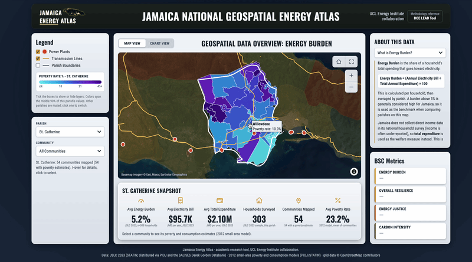

# Jamaica Energy Atlas


## Overview
The Jamaica Energy Atlas is a decision-support tool for equitable decarbonization, built as a self-contained web page (HTML, CSS and JavaScript with Plotly.js). It provides parish- and community-level analysis of energy burden, poverty, and grid infrastructure across Jamaica, designed to show where the country stands today relative to its Vision 2030 renewable energy goals and where investment could be targeted most effectively.

Jamaica's Vision 2030 National Development Plan (published 2009) originally set a goal of 20% renewables by 2030; that target was increased in 2018 to 50%. Current renewable generation sits around 10–12%. This tool is built to help visualize the gap between where Jamaica is and where it needs to be — parish by parish, community by community — rather than only at the national level.

The atlas is a single page, `index.html`, with: parish-level energy burden (real JSLC 2023 survey data); community-level poverty rate and consumption for 772 communities (2012 small-area model); grid infrastructure (transmission lines and 19 power plants, including three wind farms); a parish and community drill-down; and a Chart View. Later phases are planned to add decarbonization scenario modeling, rooftop solar potential analysis, and institutional/policy context layers — see Outputs for what is implemented now versus planned.

Built in connection with a UCL collaboration with UCL Energy Institute's Island and Coastal Resilience Lab, and inspired by tools including the Drawdown GA Emissions and Climate Solutions Trackers, the U.S. DOE's LEAD and SLOPE Tools, and PIOJ's Vision 2030 monitoring dashboards.

## Demo / Example
Open `index.html` in any modern browser. It needs an internet connection for the map library, fonts and satellite imagery, but no other files: all of its data is built into the page. The same single file can be published as-is on GitHub Pages or any web server.

## Data Sources
| Name/Description | Originator/Provider | Access Link | Date Accessed | License/Restrictions |
|---|---|---|---|---|
| Jamaica Parish Boundaries (GeoJSON) — `ja_parishes.json` | SimpleMaps | [simplemaps.com/gis/country/jm](https://simplemaps.com/gis/country/jm) | June 2026 | Free tier, see SimpleMaps terms |
| Incidence of Poverty, Jamaica (2012) — community-level poverty rate (`Per_Tot_Po`) | PIOJ / STATIN (ArcGIS small-area model) | ArcGIS web map, scraped via custom `grab_data.py` script into `jamaica_poverty_2012.geojson` | June 2026 | Public PIOJ data |
| Household Consumption per Equivalent Adult, Jamaica (2012) — community-level consumption (`av_CONS`) | PIOJ / STATIN (ArcGIS small-area model) | ArcGIS web map, scraped via custom `grab_data.py` script into `jamaica_consumption_2012.geojson` | June 2026 | Public PIOJ data |
| Jamaica Survey of Living Conditions (JSLC) Annual 2023 microdata — Annual Electricity Bill, Total Annual Expenditure, per-household | Statistical Institute of Jamaica (STATIN) [producer]; distributed via Planning Institute of Jamaica (PIOJ) and the SALISES Derek Gordon Databank, UWI Mona | Provided via Richard Leach under a SALISES Derek Gordon Databank, The University of the West Indies, Mona data use agreement | June 2026 | Non-commercial research/teaching use only — see Data Use Terms below |
| End-of-year population by parish, 2019 — `eoy_parish_pop_2019.csv` (island total 2,734,093) | Statistical Institute of Jamaica (STATIN) | [statinja.gov.jm](https://statinja.gov.jm/Demo_SocialStats/PopulationStats.aspx) | June 2026 | Public STATIN data |
| OSM Power Infrastructure (transmission lines, substations, power plants, generators) — current file `overpass_energy_infra_2_390c7e.geojson` | OpenStreetMap contributors, via Overpass Turbo | [overpass-turbo.eu](https://overpass-turbo.eu) — two queries run June 8, 2026 and June 15, 2026 (second query added `generator` and `relation` types); current file exported June 15, 2026 | June 8 & 15, 2026 | ODbL |
| Open Infrastructure Map — cross-check: 20 power plants, 1,081 MW and 741 km of power lines in Jamaica (stats page updated 2026-10-15) | Open Infrastructure Map | [openinframap.org](https://openinframap.org/stats/area/Jamaica) and [plant list](https://openinframap.org/stats/area/Jamaica/plants) | October 2026 | Data ODbL; analysis CC-BY |
| Satellite basemap imagery | Esri, Maxar, Earthstar Geographics (World Imagery tiles) | Loaded live by the page | — | Attribution required (shown on the map); check Esri terms before a public launch |
| GeoFabrik Jamaica OSM extract (roads, waterways, landuse, buildings, POIs, etc.) | GeoFabrik, via OpenStreetMap | [download.geofabrik.de/central-america/jamaica.html](https://download.geofabrik.de/central-america/jamaica.html) — downloaded as `.gpkg`, layers exported to GeoJSON via QGIS | June 2026 | ODbL |
| Population and Dwelling Counts by Community (not yet used by the current atlas) | Statistical Institute of Jamaica (STATIN), 2022 Population Census | [statinja.gov.jm/PopCensus/Census2022/Population and Dwelling counts by Community.aspx](https://statinja.gov.jm/PopCensus/Census2022/Population%20and%20Dwelling%20counts%20by%20Community.aspx) | June 2026 | Public STATIN data |

**Not yet integrated but downloaded for future use:** additional GeoFabrik layers (roads, waterways, water, landuse, places, transport, POIs, parking/gas, road infrastructure, houses of worship, buildings) — held locally in `assets/geofabrik/` for later Phase 2/3 work (e.g. rooftop solar siting).

### Data Use Terms — JSLC 2023 Microdata

Access to the JSLC 2023 microdata used for parish-level energy burden calculations is governed by a data use agreement with the **SALISES Derek Gordon Databank** (Sir Arthur Lewis Institute of Social and Economic Studies, UWI Mona). Per that agreement:

1. **Purpose:** This data is used only for non-commercial research/teaching purposes.
2. **Confidentiality:** No attempt is made to identify individuals or institutions from this data — all figures shown in this Atlas are aggregated to the parish level (14 parishes, no household-level data is displayed). The household-level survey file itself is not published; the atlas and its data files contain only parish averages and household counts.
3. **Acknowledgement:** The original depositor (Statistical Institute of Jamaica) and the SALISES Derek Gordon Databank are both credited (see citation below). STATIN and PIOJ bear no responsibility for this project's further analysis or interpretation of the data.
4. **Citation:**

   > Statistical Institute of Jamaica. *Jamaica Survey of Living Conditions, 2023* [Micro-data set]. Kingston, Jamaica: Statistical Institute of Jamaica [producer], 2023. Kingston, Jamaica: Planning Institute of Jamaica and Derek Gordon Databank, The University of the West Indies, Mona Campus [distributors], 2026.

## Data Processing and Methodology

### Software/Tools Used
- **The atlas page:** HTML, CSS and vanilla JavaScript; [Plotly.js](https://plotly.com/javascript/) 2.35.2 (MapLibre-based `choroplethmap` and `scattermap` traces) for the map and charts; Oswald and Roboto Condensed fonts (Google Fonts, SIL Open Font License)
- **Data preparation (Python):** GeoPandas, Shapely, Pandas and NumPy; `pyreadstat` reads the SPSS `.sav` microdata
- **Overpass Turbo** — OSM infrastructure querying
- **QGIS** — GeoFabrik `.gpkg` layer export to GeoJSON

### Key Processing Steps

**CRS correction.** The 2012 poverty and consumption GeoJSON files reported their CRS as EPSG:4326 (standard lat/lon), but their actual coordinate values were in EPSG:3857 (Web Mercator meters) — a mislabeling from the original scrape. Both files are force-reassigned to EPSG:3857 and then properly reprojected to EPSG:4326 before use.

**Parish name normalization.** Parish names appear inconsistently across source files (e.g. "ST. THOMAS", "St.Elizabeth", "Saint Andrew"). A normalization function strips punctuation, standardizes casing, and converts "SAINT" to "ST" to produce a consistent join key used across every dataset.

**Energy burden calculation (parish-level).** Using JSLC 2023 Annual microdata (1,719 households): `energy_burden_pct = (Annual Electricity Bill ÷ Total Annual Expenditure) × 100`, calculated per household, then averaged by parish. This directly follows the U.S. DOE LEAD Tool's methodology, substituting total expenditure for income since JSLC does not collect direct household income data (income is commonly underreported in surveys; expenditure is the standard substitute welfare measure). Averages are unweighted (the extract has no survey weights), and the 460 households that report no electricity bill are counted as 0%. Parish samples range from 56 to 318 households.

**Poverty rate and consumption (community-level).** Sourced from a 2012 PIOJ/STATIN small-area statistical model, which combines sparse JSLC survey responses with the complete 2011 Population Census to estimate values for individual communities — far more granular than JSLC's own household sample could support directly. These are modeled estimates, not direct measurements, and are labeled as such throughout the app. The consumption layer is titled "Household Consumption per Equivalent Adult" and is labeled that way in the atlas. The source GeoJSON also contains a second, overlapping set of constituency-labelled shapes with no community ID, name or estimate; these are excluded, leaving 772 communities (770 with a poverty estimate). Community outlines are simplified to about 55 m for web use. The 2012 layer has no community shapes for some areas inside a parish, so those areas appear empty when a parish is selected.

**Parish boundaries and population.** Parish outlines come from `ja_parishes.json`. The island population on the snapshot is the 2019 end-of-year total (2,734,093) from STATIN.

**OSM infrastructure extraction.** Two Overpass Turbo queries were run (June 8 and June 15, 2026). The first query returned 3,832 elements (180 ways, 3,652 nodes) but used simple line/node tagging only. The second, more complete query added `generator` and `relation` types. The current export (`overpass_energy_infra_2_390c7e.geojson`) contains 280 features: 95 transmission lines (717 km), 19 minor lines (20 km), 48 substations, 18 `power=plant` polygons and 100 `power=generator` features (62 wind turbines, 19 gas and 14 oil units, 4 solar, 1 unspecified).

**Plant selection and reconciliation.** Wind farms are not tagged as plants in OSM: they are stored as individual turbines grouped into named relations. The atlas rebuilds three wind farms from those relations (Wigton Windfarm 62.7 MW, BMR Jamaica Wind Limited 36.3 MW, Munro Wind Farm 3.0 MW; 59 turbines, 102.0 MW). Together with the plant polygons, this reconciles with Open Infrastructure Map's table (gas 5 plants / 494 MW, oil 5 / 421 MW, hydro 4 / 7.2 MW, wind 3 / 102 MW, solar 57 MW; 1,081 MW in total, against 1,081.1 MW here). The map shows 19 plants: the 15 named plant polygons, the unnamed JPS hydro plant, and the three wind farms. Two tiny unnamed solar polygons are not drawn. Open Infrastructure Map counts 3 solar plants and this file has 4 solar polygons. Capacities are as tagged in OSM; several plants have none, so capacity totals are a floor.

### Assumptions Made
- Total Annual Expenditure is used as the welfare proxy for energy burden calculations, since JSLC does not collect reliable household income data.
- 2012 small-area poverty/consumption estimates are treated as broadly indicative of current community-level conditions, despite their age — this is flagged explicitly in the app's "About This Data" panel rather than presented as current data.
- OSM-sourced infrastructure data is assumed reasonably representative of Jamaica's grid, though coverage may be incomplete in rural parishes given OSM's contributor-dependent nature.
- Energy burden averages are unweighted, and households with no electricity bill count as 0%, which lowers every parish average. Parish samples are small (56 to 318 households), so small differences between parishes should be read with caution.
- The 5% "high burden" line is a benchmark used in this atlas, not an official Jamaican threshold.
- Community poverty colors are relative to each parish (they span the middle 90% of that parish's values), so the same color in two parishes does not mean the same rate.
- "Grid Connected" (~96%) and "Renewables Share" (~15%) on the snapshot are typed in and not yet sourced; the 50% Vision 2030 target comes from the national plan.
- The fuel-source chart shows installed capacity (MW) as recorded in OpenStreetMap (1,081 MW across the 19 plants shown), not electricity generated. Five plants (1 gas, 1 oil and 3 hydro, including Old Harbour and Rockfort) have no capacity recorded and are left out of the shares, so hydro in particular is understated.
- The Balanced Scorecard (BSC) panel is intentionally blank until its metrics are defined.

## Project Structure
```
JA-Energy-Atlas/
├── index.html      # The atlas (open this)
└── README.md
```
The data files listed under Data Sources, and the scripts that prepared them (such as `grab_data.py`), are kept on the author's computer and are not included in this repository. The restricted household-level JSLC survey file is never published.

## Setup & Usage

### View or host the atlas
Open `index.html` in a browser, or upload that one file to GitHub Pages or any web host. No installation is needed.

### Updating the data
`index.html` contains all of its data. It was generated from the data files listed under Data Sources (kept on the author's computer) with Python (GeoPandas). When the underlying data changes, the page has to be regenerated; the generation scripts are not part of this repository.

## Outputs

**Implemented:**
- Map View: parish choropleth of energy burden (JSLC 2023); selecting a parish colors its communities by 2012 poverty rate and mutes the other parishes
- Parish and community drill-down by dropdown or by clicking the map, with a snapshot of parish- or community-level figures
- Grid overlay: transmission lines and 19 power plants (hover for fuel, capacity and operator; wind farms show turbine counts); layers can be switched on and off from the legend
- Chart View: energy burden by parish against the 5.0% benchmark, and recorded power plant capacity (MW) by fuel source
- "About This Data" panel with plain-language definitions, data sources and Vision 2030 context
- Balanced Scorecard (BSC) panel, intentionally left blank until the metrics are defined

**Planned:**
- Phase II: use the remaining JSLC fields (utility bill, household size, per-capita consumption, consumption quintile, area code); utility burden compared with electricity burden; a second tab for Ministry of Energy energy-supply statistics (currently PDFs); rooftop and building-based solar potential; the Balanced Scorecard / vulnerability score; a NASA VIIRS night-lights toggle
- Phase III: decarbonization scenarios (Business as Usual, MTF 2027, Vision 2030) with solar-adoption and fuel-price sliders and an LCOE pathway
- Integration of the remaining GeoFabrik layers (buildings, roads, water) for infrastructure siting analysis

## License

**Code:** MIT License

**Data:** Licenses vary by source — see the Data Sources table above. OSM-derived data (GeoFabrik, Overpass Turbo) is © OpenStreetMap contributors, licensed under ODbL. JSLC 2023 microdata is governed by a SALISES Derek Gordon Databank data use agreement — non-commercial research/teaching use only, not published in this repository, and subject to the full Data Use Terms above. PIOJ/STATIN small-area model data (2012) is public. Satellite imagery is © Esri, Maxar and Earthstar Geographics; Plotly.js is MIT-licensed.

## Contact
**Mark Lannaman**
LinkedIn: [linkedin.com/in/mark-lannaman-177551184](https://www.linkedin.com/in/mark-lannaman-177551184/)
